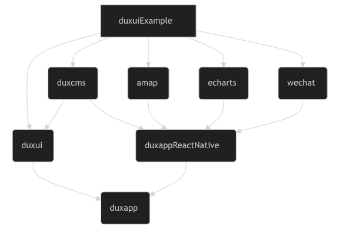

# 使用模块化项目开发框架

[原始页面](https://taro-docs-7g1t02tzaeb163c4-1252004765.tcloudbaseapp.com/docs/3.x/duxapp)

[duxapp](http://duxapp.cn)是基于 Taro 二次开发的模块化开发框架

使用这个框架，结合框架提供的 UI 库和工具库，能帮助你快速且高质量的完成项目，且能实现同时开发小程序、H5、APP（React Native），并且保证各个端的一致性

随着 Taro4.0 的推出和完善，duxapp 也将逐步完善对鸿蒙的支持

> **信息**
>
> - 需要注意的是 duxapp 框架虽然是基于 Taro 开发的，但是他不能使用在你现有的项目中，因为 duxapp 对 Taro 的结构做了许多修改，你需要通过 duxapp 提供的 CLI 创建项目，而不是使用 Taro 的 CLI
> - 这篇文档仅介绍 duxapp 框架的特性，要使用 duxapp 框架请查看完整文档[duxapp.cn](http://duxapp.cn)
>   :::
>
> <a id="什么是模块化"></a>
>
> ## 什么是模块化
>
> 就像 npm 包一样，我们可以将一些通用的功能或页面编写在一个模块内，提供给多个项目来使用，以提高代码的复用性。
>
> 模块的概念在很多后端框架中很常见，它们可以在应用商店通过安装应用的方式来获得新功能，在前端框架中确很少见到类似的设计方案，当然你其实也可以理解为发布到 npm 就是一种模块化的设计，但是在 Taro 中很多功能他并不能发布到 npm 中，例如页面。页面需要放在项目中，当发布到 npm 之后就会无法使用
>
> 在 duxapp 框架中的模块化设计原理，和 npm 的依赖关系是类似的，每个模块有一个配置文件`app.json`，里面的依赖字段`dependencies`，用来填写我要用到的依赖，就像下面`ui库示例`这个模块的配置
>
> ```jsx
> {
>   "name": "duxuiExample",
>   "description": "ui库示例",
>   "version": "1.0.13",
>   "dependencies": [
>     "duxui",
>     "duxcms",
>     "amap",
>     "echarts",
>     "wechat"
>   ]
> }
> ```
>
> 和 npm 依赖不一样的是，这里的依赖不包含版本信息。因为页面等限制条件，你一个项目中，同一个模块无法存在两个不同的版本，因此并未设计指定版本号的功能
>
> 依赖关系是逐层查找的，就像 npm 一样，例如这里依赖的`duxui`模块，他的模块配置文件是这样的
>
> ```json
> {
>   "name": "duxui",
>   "description": "DUXUI库",
>   "version": "1.0.42",
>   "dependencies": ["duxapp"],
>   "npm": {
>     "dependencies": {
>       "b-validate": "^1.5.3",
>       "react-native-view-shot": "~3.8.0",
>       "react-native-fast-shadow": "~0.1.1",
>       "array-tree-filter": "^2.1.0"
>     }
>   }
> }
> ```
>
> 在 duxui 模块中他又使用了`duxapp`这个依赖，通过每个模块都去查找，我们最终整理出这样的依赖关系图
>
> 
>
> 那么最终当我们使用下面的命令编译`duxuiExample`模块的时候
>
> ```bash
> # 调试小程序
> yarn dev:weapp --app=duxuiExample
> # 调试h5
> yarn dev:h5 --app=duxuiExample
> ```
>
> 实际被编译的模块就包含下面这些
>
> - duxuiExample
> - duxcms
> - amap
> - echarts
> - wechat
> - duxui
> - duxappReactNative
> - duxapp
>
> 模块你可以将它当做项目、组件库、工具库，甚至是对某个第三方插件的封装，就像上面依赖里面的 `wechat`，他就是对微信插件的封装，这个模块在不同的端进行了不同的封装
>
> - 小程序：未使用第三方插件 封装了小程序的分享等功能
> - H5 封装了 JSSDK，你可以使用 jssdk 的功能，也封装了公众号分享
> - APP 封装了 `react-native-wechat-lib` 插件，用来实现微信相关功能
>
> 那么当我们需要用到微信相关功能时，我们只需要在我们的模块依赖中添加 `wechat` 模块，重新编译就可以使用了

在 RN 端，当以依赖了 wechat 模块时，重新编译，会自动将 `react-native-wechat-lib` 这个原生插件打包到你的安装包中，你需要做的是在项目配置文件中配置微信插件需要的参数，如 APPID 等
:::

在 duxapp 提供的基础模块中还提供了很多基础组件和功能，像下面这些

- [支持拦截器的网络请求](https://duxapp.cn/docs/course/started/net)
- [支持拦截器的路由封装](https://duxapp.cn/docs/course/started/route)
- [跨模块渲染钩子](https://duxapp.cn/docs/course/app/renderHook)
- [多种方案的全局状态管理](https://duxapp.cn/docs/course/started/globalState)
- [快速完成分页的列表组件](https://duxapp.cn/docs/course/started/list)
- [主题系统](https://duxapp.cn/docs/course/app/theme)

<a id="开发-appreact-native"></a>

## 开发 APP(React Native)

duxapp 还针对 APP 开发（React Native）做了大量优化，大大降低了 APP 发开的难度

Taro 的 React Native 端开发提供了两种开发方式，一种是将壳和代码分离，一种是将壳和代码合并在一起开发

duxapp 中更进一步，你不需要太关注壳子什么的，你只需要安装好安卓和 ios 的编译环境，用一个命令就能编译 apk 或者 ios，并且这个编译的过程和 duxapp 的模块化理念高度绑定，通过指定 `--app=` 指定不同的入口，就能打包出不同的项目，就像下面这样

```bash
# 编译 duxuiExample 的安卓调试版本
yarn android --app=duxuiExample

# 编译 duxuiExample 的IOS调试版本
yarn ios --app=duxuiExample

# 编译成功后启动Metro代码编译服务
yarn start --app=duxuiExample
```

我们通过模块化+配置化来解决 RN 开发

<a id="配置化"></a>

### 配置化

对于 Taro 的壳子，或者原生 React Native，都会存在 `android` `ios`这两个文件夹，而在 duxapp 中，这些文件夹的内容是自动生成的，那么对于需要在这些文件夹中修改的配置内容，例如包名、版本号、新架构开关等，都通过配置文件的方式配置了，而不需要需修改具体的文件

这个配置文件是项目配置文件夹下的 `configs/duxuiExample/duxapp.js`，其中 duxuiExample 就是我通过`--app=duxuiExample` 指定的入口模块

这个配置文件的内容就像下面这样，可以清晰的看到，对安卓配置了包名、名称、版本号等信息，IOS 同样如此

```js
const config = {
  android: {
    appid: 'com.duxapp.duxui',
    appName: 'duxUI库',
    versionCode: 2,
    versionName: '1.1.0',
    keystore: {
      storeFile: 'duxui.keystore',
      keyAlias: 'duxui',
      storePassword: 'TN62eyasJAKm2ksD',
      keyPassword: 'TN62eyasJAKm2ksD',
    },
  },
  ios: {
    BundleId: 'com.duxapp.duxui',
    appName: 'duxUI库',
    versionCode: 1,
    versionName: '1.0.0',
    team: '',
    plist: {
      'duxapp/Info.plist': {
        NSCameraUsageDescription: 'duxUI库需要拍照用于APP内图片上传更换头像',
        NSContactsUsageDescription: 'duxapp需要访问你的通讯录，将客户信息保存到通讯录中',
        NSLocalNetworkUsageDescription: 'App需要访问你的本地网络，用于和服务器建立连接',
        NSLocationAlwaysAndWhenInUseUsageDescription: '使用你的位置信息用于地图定位和位置选择',
        NSLocationAlwaysUsageDescription: '使用你的位置信息用于地图定位和位置选择',
        NSLocationWhenInUseUsageDescription: '使用你的位置信息用于地图定位和位置选择',
        NSPhotoLibraryAddUsageDescription: 'duxUI库需要保存宣传图到你的相册用于分享',
        NSPhotoLibraryUsageDescription: 'duxUI库需要访问相册用于APP内图片上传更换头像',
      },
    },
  },
}

module.exports = config
```

<a id="内容复制"></a>

### 内容复制

上面这个配置文件已经解决了大部分打包需要用到的配置，但是你开发过 RN 的话你会看出来，证书他是一个文件，这里只指定了证书文件名称，但是并未指定证书具体内容，还有打包一个 app，它总是需要一个 app 图标的，包括安卓和 ios 的图标，那么这些内容，可以通过配置文件中的 copy 文件夹，将这些项目文件复制到安卓或者 ios 对应的文件位置

[查看这个文档获取更多内容复制的信息](https://duxapp.cn/blog/react-native#%E5%86%85%E5%AE%B9%E5%A4%8D%E5%88%B6)

<a id="三方插件"></a>

### 三方插件

你的项目或多或少都要用一些第三方的插件，`React Native`基础模块中已经包含了很多基础常用插件，你可以通过[三方模块](http://duxapp.cn/docs/app/duxappReactNative/start#%E4%B8%89%E6%96%B9%E6%A8%A1%E5%9D%97)查看到，包含的基础插件

传统的方法是将他们添加到 `package.json` 依赖中，然后根据文档内容修改安卓或者 ios 文件夹对应的内容，在 duxapp 中提供了另外一种方式来实现第三方插件的使用

像这个`react-native-view-shot`安装方式很简单的插件，他只要求你将他添加到 `package.json` 的依赖中就可以使用了

那么我们结合模块，在你需要用到这个功能的模块配置文件中，一样的添加上这个依赖即可，像下面这个`duxui`模块的配置文件一样

```json
{
  "name": "duxui",
  "description": "DUXUI库",
  "version": "1.0.42",
  "dependencies": ["duxapp"],
  "npm": {
    "dependencies": {
      "b-validate": "^1.5.3",
      "react-native-view-shot": "~3.8.0",
      "react-native-fast-shadow": "~0.1.1",
      "array-tree-filter": "^2.1.0"
    }
  }
}
```

其实开源的大多数第三方插件都是这样的，只需要添加到依赖中，重新打包就能用了，但是很少数的插件，他就是要改一些安卓或者 ios 里面的原生内容，像微信插件，它需要的改动还挺多的

你可以阅读这边文档，来了解微信插件是如何封装的 [三方模块](http://duxapp.cn/blog/react-native#%E4%B8%89%E6%96%B9%E6%A8%A1%E5%9D%97)

<a id="多端-ui-库"></a>

## 多端 UI 库

duxui 是 duxapp 官方开发的一款兼容多端的 UI 组件库，兼容小程序、H5、React Native，库中提供了 60+的组件，覆盖大部分使用场景

它能帮助你通过统一的组件样式，快速完成多端应用的开发，包括 React Native 端的 APP 开发

如果你想看到这些组件的展示效果，请根据不同的端进行查看

- 小程序  
  
- APP [https://app.share.dux.plus/cn.duxapp.duxui](https://app.share.dux.plus/cn.duxapp.duxui)
- H5 [https://duxui.duxapp.cn](https://duxui.duxapp.cn)

如果你想通过项目来查看这些组件的运行效果或者组件源码，使用下面这个命令创建一个 UI 库的示例代码

```bash
npx duxapp-cli create projectName duxuiExample
```

其中的 `projectName` 是要创建的项目名称，创建之后根命令行据提示进行下一步操作

UI 库开发文档[http://duxapp.cn/docs/duxui/start](http://duxapp.cn/docs/duxui/start)
